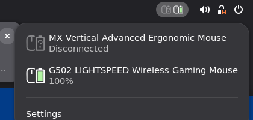

# LGSTray Battery for GNOME Shell

A GNOME Shell extension that shows the battery of Logitech mice, keyboards and headsets in the top bar, using the same icons as the Windows tray app.




- One icon per device, with the battery level indicator
- A charging bolt while the device is charging
- A dimmed `?` when a device that was seen this session is turned off or disconnected
- Click for a menu with each device's name and status
- Optional numeric mode, like *Display Numeric Icon* on Windows

## How it works

Nothing extra runs in the background. On Linux the kernel's `hid-logitech-dj` and `hid-logitech-hidpp` drivers already talk HID++ to Unifying, Bolt and Lightspeed receivers, and to devices plugged in by cable. They publish battery level and charging state through UPower, which the extension reads with `UPowerGlib`.

If `upower --dump` doesn't list your device, the extension can't see it either. That usually means the kernel driver doesn't support the device yet.

## Requirements

- GNOME Shell 45 to 50
- UPower (installed by default with GNOME)

## Install

From the repository root:

```sh
cd linux/gnome-extension
gnome-extensions pack lgstraybattery@ecameracci.github.com --extra-source=icons --force
gnome-extensions install --force lgstraybattery@ecameracci.github.com.shell-extension.zip
```

Log out and back in (needed on Wayland so GNOME Shell picks up the new extension), then enable it:

```sh
gnome-extensions enable lgstraybattery@ecameracci.github.com
```

You can also enable it from the **Extensions** app. To remove it:

```sh
gnome-extensions uninstall lgstraybattery@ecameracci.github.com
```

## Settings

Open them from **Settings** in the extension's menu, the **Extensions** app, or with `gnome-extensions prefs lgstraybattery@ecameracci.github.com`:

- **Show battery percentage as a number**: replaces the icon in the top bar with the percentage.
- **Only show Logitech devices** (on by default): turn this off to include any wireless mouse, keyboard or headset that UPower reports.

## Notes

- UPower removes a wireless device from its list when the link goes down. The extension remembers devices for the current session so it can show them as disconnected. A device that is already off when you log in doesn't appear until it is turned on.
- UPower reports any device at 100% as "fully charged", whether it is plugged in or not. So the bolt only appears while the battery is actually charging, unlike the Windows app, which also shows it for a full device still on the cable.

## Development

Run a nested GNOME Shell to try changes without logging out:

```sh
dbus-run-session -- gnome-shell --devkit --wayland
```

On GNOME 45 to 48, use `--nested` instead of `--devkit`. Errors from the extension show up in that terminal, or in `journalctl -f -o cat /usr/bin/gnome-shell` for your main session.
