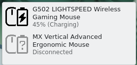
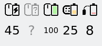

# LGSTray Battery for KDE Plasma

A Plasma 6 widget that shows the battery of Logitech mice, keyboards and headsets in the panel, using the same icons as the Windows tray app.





- One icon per device, with the battery level indicator
- A charging bolt while the device is charging
- A dimmed `?` when a device that was seen this session is turned off or disconnected
- Click for a list with each device's name and status; hover for a tooltip
- Optional numeric mode, like *Display Numeric Icon* on Windows

## How it works

Nothing extra runs in the background. On Linux the kernel's `hid-logitech-dj` and `hid-logitech-hidpp` drivers already talk HID++ to Unifying, Bolt and Lightspeed receivers, and to devices plugged in by cable. They publish battery level and charging state through UPower. The widget reads UPower through Plasma's `powermanagement` data engine, which is the same source as Plasma's own Battery and Brightness widget.

If `upower --dump` doesn't list your device, the widget can't see it either. That usually means the kernel driver doesn't support the device yet.

## Requirements

- KDE Plasma 6.0 or later
- UPower (installed by default with Plasma)

## Install

From the repository root:

```sh
kpackagetool6 --type Plasma/Applet --install linux/kde-plasmoid/package
```

Then right-click the panel, choose **Add or Manage Widgets**, and add **LGSTray Battery**. To put it in the system tray instead, open the system tray's settings and enable it under **Entries**.

To update after pulling changes:

```sh
kpackagetool6 --type Plasma/Applet --upgrade linux/kde-plasmoid/package
```

To remove:

```sh
kpackagetool6 --type Plasma/Applet --remove com.github.ecameracci.lgstraybattery
```

## Settings

Right-click the widget and choose **Configure LGSTray Battery**:

- **Show battery percentage as a number**: replaces the icon with the percentage.
- **Only show Logitech devices** (on by default): turn this off to include any wireless peripheral that UPower reports.

## Notes

- UPower removes a wireless device from its list when the link goes down. The widget remembers devices for the current session so it can show them as disconnected. A device that is already off when you log in doesn't appear until it is turned on.
- UPower reports any device at 100% as "fully charged", whether it is plugged in or not. So the bolt only appears while the battery is actually charging, unlike the Windows app, which also shows it for a full device still on the cable.
- How fast "disconnected" shows depends on when the kernel and UPower notice the device is gone. Some devices only report it after a short delay.

## Development

Test without installing:

```sh
plasmoidviewer --applet linux/kde-plasmoid/package
```

The viewer shows the popup content directly, since the widget only switches to its panel icons when it's narrower than about 10 grid units. To check the panel icons, install the package and add the widget to a panel.
